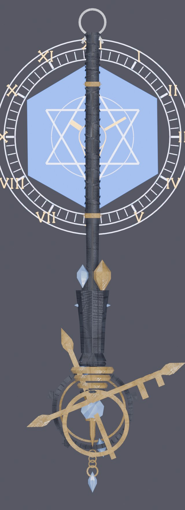
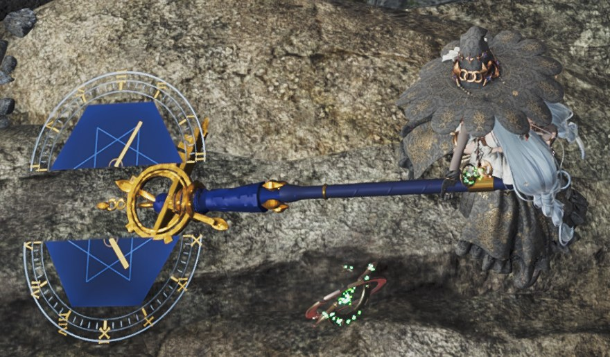
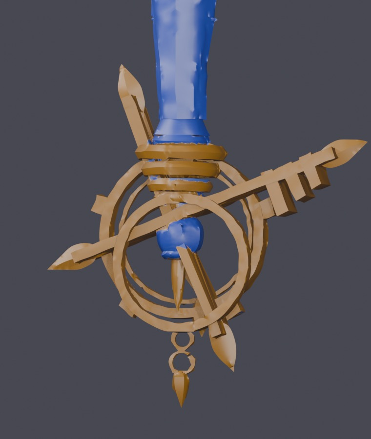
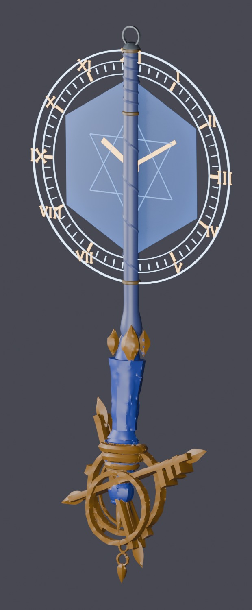

# 法杖盾斧

《怪物猎人 荒野》充能斧外观替换：日式魔女法杖 + 时钟法阵。

替换武器：**白炽斧耶利米 / 炽光斧耶利米**

实机：

| 持杖 | 斧形态 |
|---|---|
|  |  |

杖头特写与斜视： 

## 下载

[RuneStaff-v1.1.zip](RuneStaff-v1.1.zip)

## 更新（v1.1）

- **杖头**：回到原始设计做保形精修——双环、斜向三齿、长针、蓝色轴心与挂饰都保留，补了局部倒角与曲面修整，清掉退化薄片。
- **杖身**：重建连续杆体、缠带与尾环，修掉重拓扑留下的断续和碎面。
- **材质**：金属、深蓝表面、宝石分区控制反射与粗糙度，不再整根一个手感；法阵改用平坦法线，不再吃原版武器的凹凸贴图。
- **法阵**：发光单独控制，外环与指针更清楚；蓝膜加了柔和渐变，星纹提亮。

v1.0 → v1.1 是同一套设计的一次精修，替换目标、安装方式、法阵显隐逻辑都没有变。

## 前置

- REFramework。没有它 `pak_mods` 不加载，mod 无效。
- REFramework → Advanced Options → 打开 **Alternate PAK Folder**。

## 安装

把 `RuneStaff-v1.1.zip` 拖进 Fluffy Mod Manager，启用。

## 效果

- 剑盾形态按住 R 防御：法阵出现
- 剑盾形态平时：法阵隐藏
- 斧形态：法阵常显

## 卸载

Fluffy 里取消勾选或删除。

## 排错

| 症状 | 处理 |
|---|---|
| 没有任何变化 | 检查 REFramework 和 Alternate PAK Folder |
| 杖身是默认材质 | 贴图没读到，反馈一下 |
| 防御时法阵不出 | 确认 `<游戏目录>\reframework\autorun\rune_guard_circle.lua` 在。日志：`<游戏目录>\reframework\data\rune_guard_circle.log` |
| 法阵闪烁 | 装过 ArmorVariantManager 且配过这把武器的显隐。删掉 `reframework\data\ArmorVariantManager\it0900_0021.json` |

不需要"防御时才显示"的话，删掉 `rune_guard_circle.lua`，法阵就常显。

## 附注

截图中的角色皮肤是 mod「理科魔女 / Witch Shinano」，作者 Fruit milk。

- 主页：[space.bilibili.com/2438342](https://space.bilibili.com/2438342)
- 本 mod 不分发它，也不依赖它。法杖配饰的造型参考了那个角色的设计。

v1.1 的几何经由 Tripo AI 重拓扑回传，再在 Blender 里做保形精修与材质调整；打包用 [ree-pak-cli](https://github.com/NSACloud/ree-pak-cli)，网格导入导出用 RE-Mesh-Editor。

## 许可

与 Capcom 无关联。《怪物猎人 荒野》及其资产版权归 Capcom。

`RuneStaff.pak` 是游戏原有资源的修改产物，请在自己拥有该游戏的机器上使用。

内置的 `rune_guard_circle.lua` 为本项目原创，MIT。
