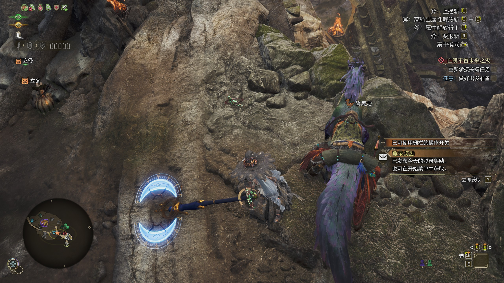
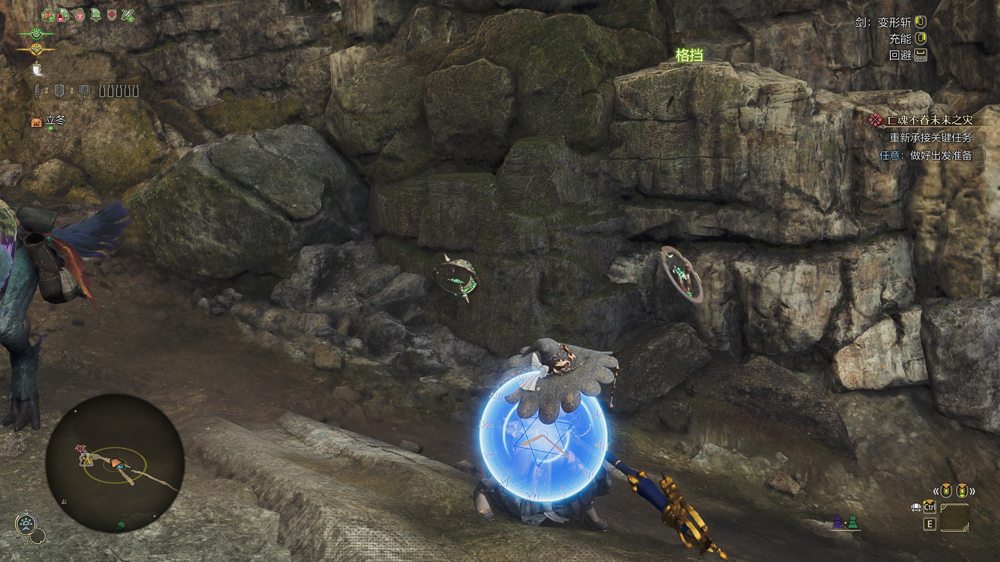

# 法杖盾斧

《怪物猎人 荒野》充能斧外观替换：日式魔女法杖 + 时钟法阵。

替换武器：**白炽斧耶利米 / 炽光斧耶利米**

| 剑盾形态 · 透明蓝色法阵 | 持杖造型（早期截图） |
|---|---|
|  |  |

## 下载

[RuneStaff-v1.3.zip](RuneStaff-v1.3.zip)

## 更新（v1.3）

- **透明能量膜**：法阵可以透出后方角色与场景，膜面保留蓝色。
- **完整圆形盾膜**：能量膜铺至钟圈内缘，不再是内接多边形。
- **青蓝发光**：强化边缘、膜内弧纹与中心层次，双月斧同步更新。
- 保留剑盾完整法阵 / 斧态双月的切换、原钥匙杖头与蓝色轴心。

本版已由作者实机验收；上方盾、斧截图均来自 v1.3 定稿。

## 前置

- REFramework。
- REFramework → Advanced Options → 打开 **Alternate PAK Folder**。
- Fluffy Mod Manager。

## 安装

先在 Fluffy 中停用旧版，再把 `RuneStaff-v1.3.zip` 拖进 Fluffy Mod Manager 并启用。

包内包含 `RuneStaff.pak` 和 `reframework/autorun/rune_guard_circle.lua`，请整套更新。新版脚本与五组材质配套，勿混用旧版脚本。

如果曾手动安装本 mod 的 patch pak，应先移出对应旧文件，避免与 Fluffy 版重复加载。

## 效果

- 剑盾形态按住防御：完整星钟法阵出现；放下防御后短暂保留，再隐藏。
- 斧形态：发光双月刃常显。

## 卸载

Fluffy 中停用本 mod。

## 排错

| 症状 | 处理 |
|---|---|
| 没有任何变化 | 检查 REFramework、Alternate PAK Folder，以及旧版是否重复加载 |
| 材质不对或透明膜不见 | 确认 pak 与 Lua 都来自 v1.3，并停用旧版本后重新启用 |
| 防御时法阵不出 | 确认游戏目录下 `reframework/autorun/rune_guard_circle.lua` 在；日志为 `reframework/data/rune_guard_circle.log` |
| 法阵闪烁或两态混在一起 | 若 ArmorVariantManager 配过这把武器，将其 `reframework/data/ArmorVariantManager/it0900_0021.json` 备份并改为 `.off` |

## 附注

截图中的角色皮肤是 mod「理科魔女 / Witch Shinano」，作者 Fruit milk。

- 主页：[space.bilibili.com/2438342](https://space.bilibili.com/2438342)
- 本 mod 不分发它，也不依赖它。法杖配饰的造型参考了那个角色的设计。

几何经由 Tripo AI 重拓扑回传，再在 Blender 里做保形精修、双态拆分与材质调整；打包用 [ree-pak-cli](https://github.com/NSACloud/ree-pak-cli)，网格导入导出用 RE-Mesh-Editor。

## 许可

与 Capcom 无关联。《怪物猎人 荒野》及其资产版权归 Capcom。

`RuneStaff.pak` 是游戏原有资源的修改产物，请在自己拥有该游戏的机器上使用。

内置的 `rune_guard_circle.lua` 为本项目原创，MIT。
